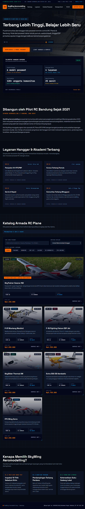
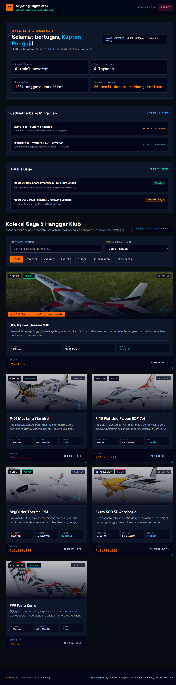
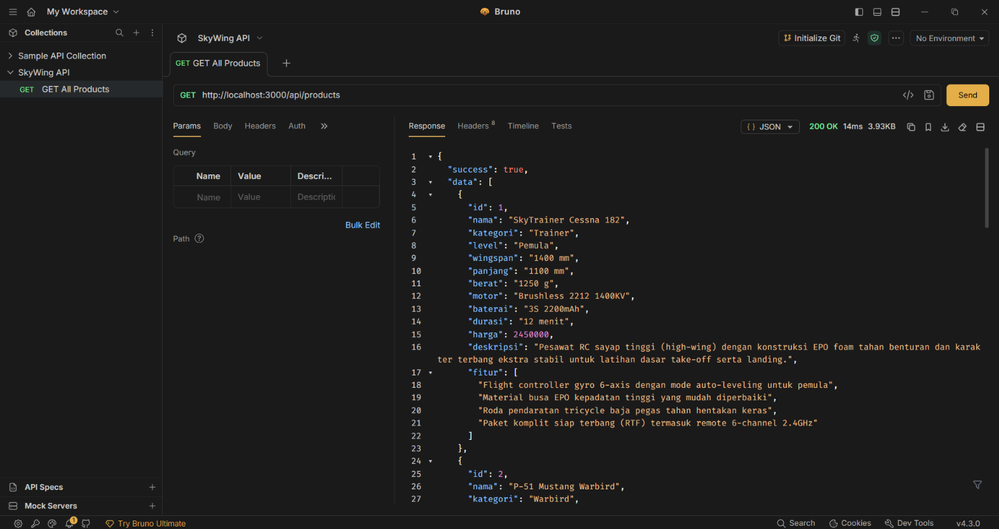
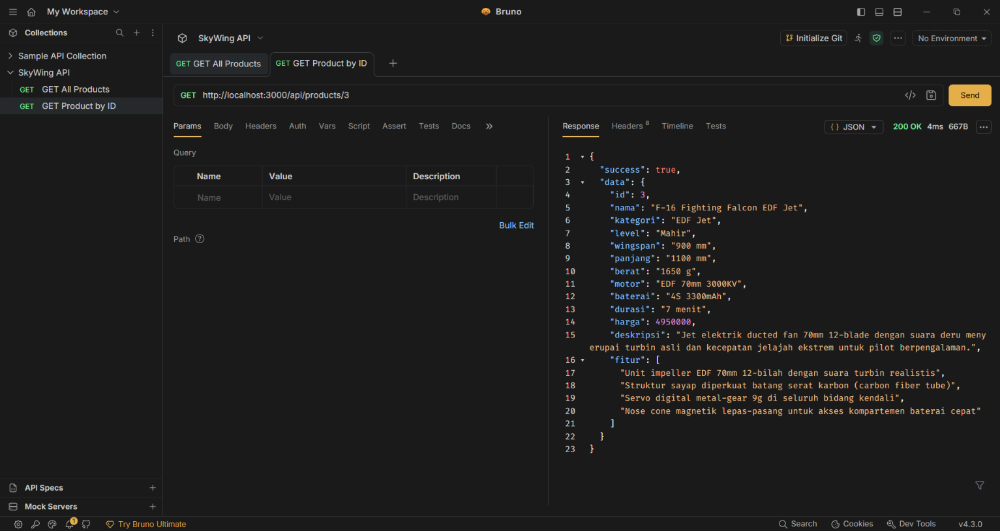
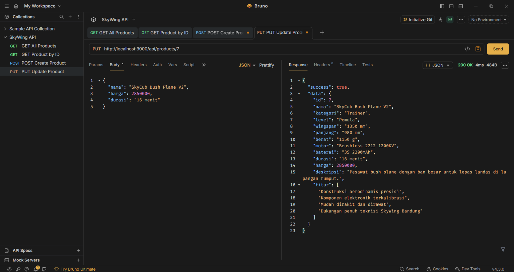
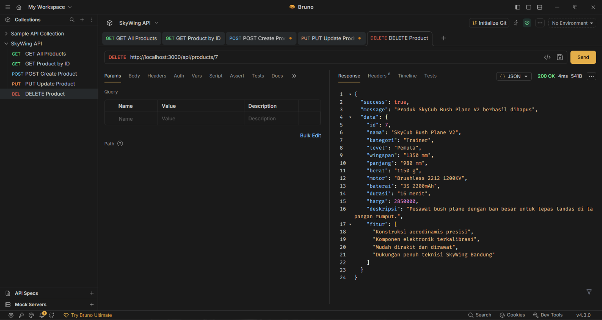

# SkyWing Aeromodelling — UTS Pemrograman Web

1. **Project 1 (`project-1/`)**: Website statis 5 halaman menggunakan HTML5, Tailwind CSS v4, dan Vanilla JavaScript.
2. **Project 2 (`project-2/`)**: REST API CRUD menggunakan Node.js dan Express dengan sumber data JSON yang identik dengan Project 1.

---

## Cara Menjalankan Project

### A. Menjalankan Project 1 (Website Statis)
1. Buka folder `project-1/`.
2. Klik dua kali file `index.html` untuk membukanya langsung di browser, atau jalankan melalui ekstensi **Live Server** di VS Code / server statis lokal:
   ```bash
   npx serve project-1
   ```

### B. Menjalankan Project 2 (REST API CRUD)
1. Buka terminal dan masuk ke direktori `project-2`:
   ```bash
   cd project-2
   ```
2. Instal seluruh dependensi:
   ```bash
   npm install
   ```
3. Jalankan server API:
   ```bash
   npm start
   ```
4. Server akan aktif di `http://localhost:3000`.

---

## Akun Demo (Project 1)

Gunakan akun berikut pada halaman `login.html` (tersedia juga tombol **Isi Otomatis** di halaman login):
- **Email**: `admin@skywing.id`
- **Password**: `admin123`

---

## Daftar Endpoint REST API (Project 2)

| Method | Endpoint | Deskripsi |
|--------|----------|-----------|
| GET | `/` | Menampilkan pesan sambutan API dan daftar endpoint |
| GET | `/api/products` | Mengambil seluruh daftar 6 produk pesawat RC |
| GET | `/api/products/:id` | Mengambil detail 1 produk berdasarkan `id` (404 jika tidak ditemukan) |
| POST | `/api/products` | Menambahkan produk baru (`id` otomatis `maxId + 1`, 400 jika `nama`/`harga` kosong) |
| PUT | `/api/products/:id` | Memperbarui data produk berdasarkan `id` (404 jika tidak ada, 400 jika `nama`/`harga` kosong) |
| DELETE | `/api/products/:id` | Menghapus produk berdasarkan `id` (404 jika tidak ditemukan) |

---

## Skenario & Tabel Verifikasi Tes API

> Catatan: Tabel di bawah ini merupakan matriks skenario pengujian standar untuk diverifikasi langsung menggunakan Bruno saat server dijalankan di mesin lokal.

| Skenario Tes | Method & Endpoint | Body Payload | Expected Status | Expected Response |
|--------------|-------------------|--------------|-----------------|-------------------|
| Ambil semua produk | `GET /api/products` | - | `200 OK` | `{ "success": true, "data": [ ...6 produk ] }` |
| Ambil produk ID 3 | `GET /api/products/3` | - | `200 OK` | `{ "success": true, "data": { "id": 3, "nama": "F-16 Fighting Falcon EDF Jet", ... } }` |
| Tambah produk baru | `POST /api/products` | `{ "nama": "SkyCub Bush Plane", "harga": 2750000, ... }` | `201 Created` | `{ "success": true, "data": { "id": 7, ... } }` |
| Ubah produk ID 7 | `PUT /api/products/7` | `{ "nama": "SkyCub Bush Plane V2", "harga": 2850000, "durasi": "16 menit" }` | `200 OK` | `{ "success": true, "data": { "id": 7, ... } }` |
| Hapus produk ID 7 | `DELETE /api/products/7` | - | `200 OK` | `{ "success": true, "message": "Produk SkyCub Bush Plane V2 berhasil dihapus", ... }` |

---

## Dokumentasi Screenshot

### A. Project 1 — Frontend Web SkyWing Aeromodelling

1. Halaman Utama (`index.html`)


2. Halaman Detail Informasi (`detail.html?id=5`)


3. Halaman Login (`login.html`)


4. Halaman Registrasi (`register.html`)


5. Halaman Menu Utama / Dashboard (`dashboard.html`)


---

### B. Project 2 — Pengujian CRUD API di Bruno

1. GET All Products (`GET /api/products`)


2. GET Product by ID (`GET /api/products/3`)


3. POST Create Product (`POST /api/products`)


4. PUT Update Product (`PUT /api/products/7`)


5. DELETE Product (`DELETE /api/products/7`)


---

## Identitas Pengembang

`@Copyright by 24552011240_Muhammad Mugni Mahbub_TIF RP 24E CNS`

---

## Catatan Arsitektur Teknis

Catatan arsitektur dan optimasi project:

- **Tailwind lokal**: `project-1/js/tailwind-browser.js` (di-vendor, bukan
  CDN) — halaman tetap tampil penuh saat offline.
- **Gambar lokal bernama jelas**: `project-1/images/` — 6 foto produk +
  1 foto hero. Lihat `project-1/images/README.md` untuk tabel produk →
  nama file dan cara menggantinya. Foto hero memakai foto yang sama dengan
  Cessna 182 (sesuai aslinya).
- **Harga API jadi number**: `project-2/data/products.json` kini memakai
  `2450000` dst (bukan string `"Rp2.450.000"`), sama seperti `data.js`.
  Tampilan harga di website tidak berubah (tetap `Rp2.450.000`).
- **Kode diringkas tanpa memangkas fitur**: blok `<style>` yang sama di
  5 halaman diekstrak ke `project-1/css/design.css`; inline `<script>` di
  tiap halaman dipindah ke `project-1/js/` (`index.js`, `detail.js`,
  `dashboard.js`, `login.js`, `register.js`); template kartu produk
  "Pesawat lain yang mirip" di detail kini memakai ulang template kartu
  katalog dari `js/filter.js` (`productCardHTML`).
- Google Fonts masih dimuat dari internet, dengan fallback font sistem
  kalau offline — tampilan tetap rapi tanpa font tersebut.
